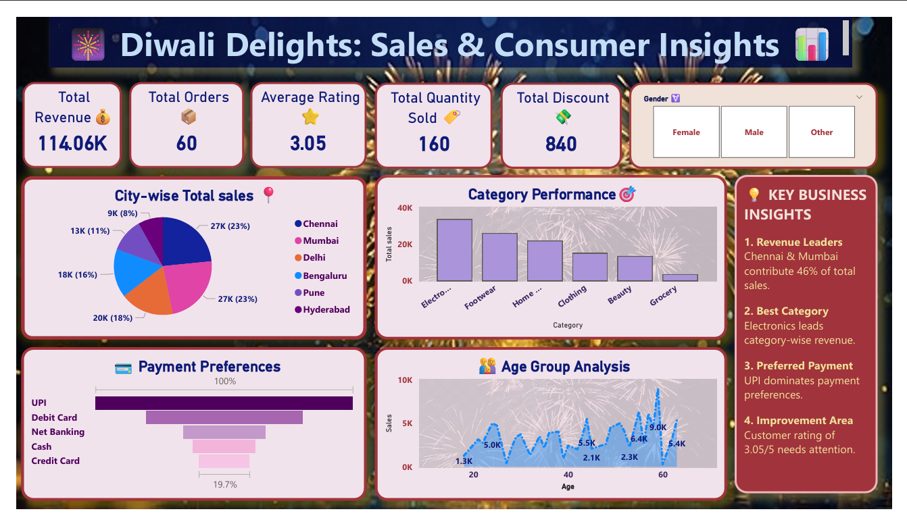

<div align="center">

# 🪔 Diwali Sales Analysis
### Python • Exploratory Data Analysis • Power BI

<a href="https://git.io/typing-svg">
  
</a>


**An end-to-end sales analytics project exploring revenue, customer behaviour and product demand during the Diwali festive season.**

</div>

---

## 📌 Project Overview

This project analyses Diwali sales data to understand sales performance, customer purchasing behaviour and product demand. Python was used for data cleaning, preprocessing and exploratory data analysis (EDA). The prepared dataset was then loaded into Power BI to create a dashboard that communicates key performance indicators and business trends.

The goal is to turn raw sales data into clear findings that can support better marketing, inventory and customer-experience decisions for future festive seasons.

## 🎯 Objectives

- Clean and prepare the Diwali sales dataset for analysis.
- Explore sales patterns and customer behaviour using Python.
- Identify leading cities and high-performing product categories.
- Present key metrics and findings in an interactive Power BI dashboard.
- Translate the analysis into practical business recommendations.

## 🧰 Tools & Technologies

| Tool / Technology | How it was used |
|---|---|
| **Python** | Overall data analysis workflow |
| **Pandas** | Data loading, cleaning, manipulation and preprocessing |
| **Matplotlib** | Charts and visual exploration |
| **Seaborn** | Statistical visualisations and EDA |
| **Microsoft Excel** | Source dataset |
| **Microsoft Power BI** | Dashboard development and business reporting |

## 🔄 Project Workflow

1. **Dataset** — Worked with the Diwali sales dataset in Excel.
2. **Data cleaning** — Inspected the data and handled preparation tasks using Python and Pandas.
3. **Preprocessing** — Prepared the data for reliable analysis.
4. **Exploratory data analysis** — Used Pandas, Matplotlib and Seaborn to investigate sales trends and customer patterns.
5. **Dashboard development** — Loaded the prepared dataset into Power BI and built a sales insights dashboard.
6. **Insights & recommendations** — Summarised the findings and identified areas for business attention.

## 📊 Power BI Dashboard

The **Diwali Delights: Sales & Consumer Insights** dashboard provides a consolidated view of sales performance.

### Dashboard preview

<div align="center">
  
  <p><em>Power BI dashboard — Diwali Delights: Sales & Consumer Insights</em></p>
</div>

### Key dashboard metrics

| KPI | Result |
|---|---:|
| Total revenue | **114.06K** |
| Total orders | **60** |
| Quantity sold | **160** |
| Average rating | **3.05 / 5** |
| Total discount | **840** |

### Dashboard views

- **City-wise sales:** Compares revenue contribution across cities.
- **Category performance:** Highlights the categories generating the most revenue.
- **Payment preferences:** Shows the distribution of payment methods.
- **Age-group analysis:** Explores sales across customer age values.
- **KPI summary:** Presents the headline sales metrics in one view.

## 🔍 Key Business Insights

### 1. City contribution
- **Chennai and Mumbai** are the leading cities, contributing approximately **27K each** (around **23% apiece**).
- Together, they account for approximately **46% of total revenue**.
- Delhi contributes around **20K**, followed by Bengaluru at **18K**, Pune at **13K** and Hyderabad at **9K**.

### 2. Category performance
- **Electronics** is the leading category, generating approximately **33K**.
- Footwear follows at around **25K**, while Home Decor contributes approximately **21K**.
- Grocery records the lowest category revenue at approximately **3K**, making it an area for further investigation.

### 3. Customer experience
- The average customer rating is **3.05/5**. This indicates an opportunity to investigate customer feedback and identify improvements to the shopping experience.

### 4. Payment preferences
- The dashboard indicates that **UPI is the leading payment preference** in the dataset.

## 💡 Business Recommendations

| Focus area | Recommended action |
|---|---|
| Leading markets | Plan local campaigns and inventory for Chennai and Mumbai, while monitoring opportunities in other cities. |
| Strong categories | Protect product availability in Electronics and align promotions with category demand. |
| Low-performing category | Investigate Grocery demand, assortment, pricing and product visibility before making investment changes. |
| Customer experience | Review feedback behind the 3.05/5 average rating and track improvements over time. |
| Payments | Keep UPI convenient while continuing to monitor payment preferences. |

## 📚 Key Learnings

- Practised data cleaning and preprocessing using Python and Pandas.
- Strengthened EDA skills by exploring sales and customer patterns.
- Used Matplotlib and Seaborn to communicate findings visually.
- Learned how to move a prepared dataset from Python into Power BI.
- Built a dashboard that brings multiple business metrics together.
- Developed the ability to convert analytical observations into business recommendations.

## 🗂️ Repository Structure

```text
Diwali-Sales-Analysis/
│
├── README.md
│
├── images/
│   └── Dashboard.png
│
├── python files/
│   ├── data_cleaning_preproc.py
│   ├── Diwali_Ecommerce_Sales_Analysis.py
│   ├── MATPLOTLIB & SEABORN VISUALIZATION.py
│   ├── Pandas_analysis.py
│  
│
└── power_BI/
    └── Diwali_sales_analysis_dashboard.pbix
```

> **Note:** The tree above reflects the file and folder names supplied for this project. If your Python files use `.ipynb` or another extension, update the extensions in this tree to match the actual files.

## 🚀 How to Explore This Project

1. Open the Python files in Jupyter Notebook, VS Code or another Python environment.
2. Install the required libraries: `pandas`, `matplotlib` and `seaborn`.
3. Update the dataset path in the code if needed, then run the analysis files.
4. Open `power_BI/Diwali_sales_analysis_dashboard.pbix` in Power BI Desktop to explore the dashboard.

## 👩‍💻 Project Takeaway

This project demonstrates a complete analytics workflow — from preparing and exploring sales data with Python to presenting business findings through Power BI. The analysis points to strong revenue contribution from Chennai and Mumbai, Electronics as the leading category, and Grocery and customer ratings as areas worth investigating further.

---

<div align="center">

**Thanks for visiting this project!** ✨

*Turning data into decisions, one insight at a time.*

</div>
